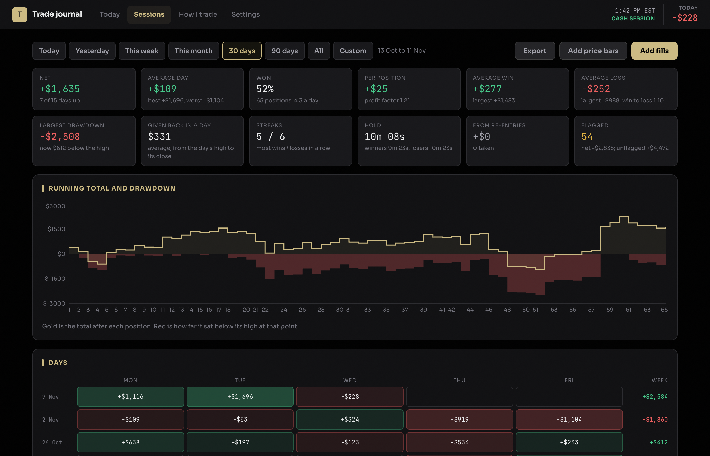
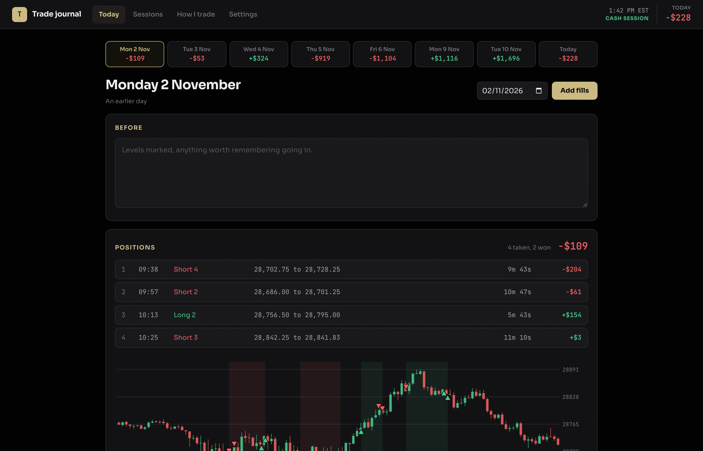
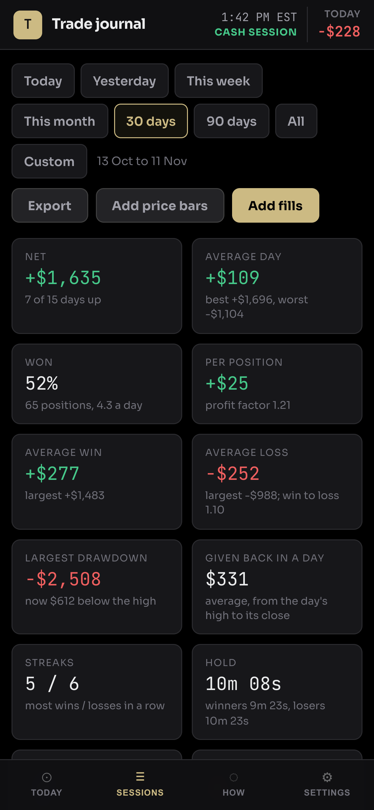
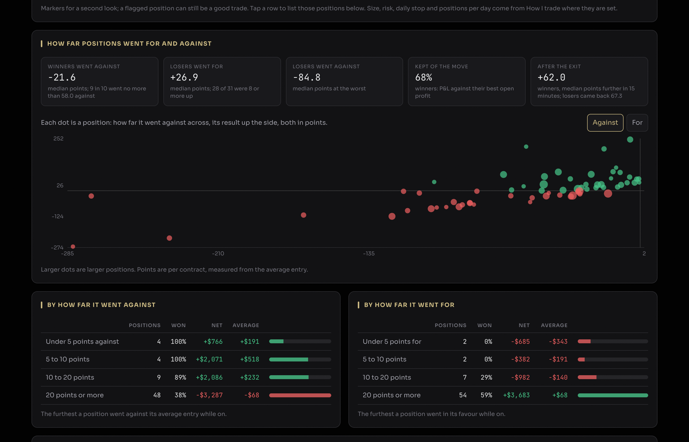

# Trade journal

A private trading journal for futures day traders that runs on your own Cloudflare account, on the free plan.

You, or an AI agent working for you, send the fills from your platform. The journal groups them into positions,
works out P&L and statistics, fetches one-minute price bars, and shows how far each trade went for and against
you (MAE and MFE). Nothing is typed in by hand unless you want to.



## What it does

- **Positions from raw fills.** Send every partial entry and exit; the journal groups them flat to flat into
  positions. Ten 2-lot round trips on a platform report can be four positions here. Built for traders who scale in
  and out.
- **Agents send the trades.** Make an API key in Settings, give the ready-made prompt to your agent (a personal
  AI assistant, a bot, a script), and it posts each day's fills. Screenshots of a platform's trade log work as well
  as exports, as long as the agent can read them. See [docs/agents.md](docs/agents.md).
- **Paste-in import** for days you would rather add yourself: paste the platform's trade table.
- **Today page:** notes before and after the session, the day's positions, and a one-minute chart with every fill
  marked. Tap it for a full-screen chart that scrolls and zooms.
- **Sessions page:** today, yesterday, a week, a month, 30 or 90 days, all, or any two dates. Totals, profit factor,
  drawdown, streaks, a calendar of days, breakdowns by time of entry, hold time, side, size, position number,
  weekday, label and re-entries, and a resampled view of where the next 20 days could land.
- **MAE and MFE:** how far each position went for and against its average entry, in points and in dollars at the
  size actually held, and what price did in the 15 minutes after the exit.
- **Flags for review:** positions larger than usual, sized up after a loss, added to while behind, up first and
  then closed at a loss, and more. A table shows how each kind of flagged position did. Mark any position for
  review by hand.
- **Your time zone:** detected from your browser on the first visit and changeable in Settings. Daylight saving
  is handled everywhere. Trading days follow New York, where the session is defined.
- **Works on a phone.**

| | |
|---|---|
|  |  |



The screenshots show made-up trades on real NQ prices, made with [scripts/demo-data.mjs](scripts/demo-data.mjs).

**Instruments:** P&L, positions and price bars cover the CME Nasdaq-100 and S&P 500 futures: NQ, MNQ, ES and MES.
Fills for other instruments are stored as sent but not yet turned into positions. Adding one is a few lines (see
[Adding an instrument](#adding-an-instrument)).

## Deploy

You need a free Cloudflare account. Pick one of the three ways below.

### 1. The Deploy button

[](https://deploy.workers.cloudflare.com/?url=https://github.com/AshutoshShah/trade-journal)

Cloudflare copies this repository to your GitHub account, creates the Worker and its D1 database, and asks for
`APP_PASSWORD`, the password for your journal. Choose a long one: the journal refuses the example value and
anything shorter than 12 characters. When it finishes, open the `workers.dev` address
it shows and sign in. Every push to your copy deploys again.

### 2. From a terminal

Needs Node.js 20 or later.

```bash
git clone https://github.com/AshutoshShah/trade-journal.git
```

```bash
cd trade-journal && npm install
```

```bash
npx wrangler login
```

```bash
npx wrangler deploy
```

The first deploy creates the D1 database and prints the journal's address. Then set the password and open that
address:

```bash
npx wrangler secret put APP_PASSWORD
```

### 3. Let an AI agent do it

If you use a coding agent that can run commands on your computer (Claude Code, Codex, Cursor or similar), paste
this to it:

```text
Set up Trade journal for me on my Cloudflare account, from https://github.com/AshutoshShah/trade-journal.
Follow docs/setup-with-an-agent.md in that repository step by step. Ask me before anything that needs my
decision, and when it is done, tell me the journal's address and how to sign in.
```

The agent clones the repository, signs you in to Cloudflare (you approve that in your browser), deploys, sets a
password and checks that everything answers as it should. The steps it follows are in
[docs/setup-with-an-agent.md](docs/setup-with-an-agent.md), so you can read exactly what it will do.

## First steps

1. Open the journal and sign in. Your time zone is taken from the browser; change it in **Settings** if needed.
2. In **Settings**, under **Agents and scripts**, make a key and copy the prompt it shows. Give that prompt to your
   agent. From then on, send it your trade log or a screenshot of it after each session and it posts the fills.
3. Or paste a day yourself with **Add fills** on the Today or Sessions page.
4. Optionally, describe your approach on **How I trade** and set a usual size, risk per position, daily stop and
   positions per day there. The flags on Sessions use those numbers.

## Configuration

| Setting | Where | What it does |
|---|---|---|
| `APP_PASSWORD` | Secret | The journal password, 12 characters or more. Required in password mode. Changing it signs every browser out. |
| `AUTH` | Variable in `wrangler.toml` | `password` (default) or `access`. See below. |
| `ACCESS_TEAM_DOMAIN`, `ACCESS_AUD` | Variables | Needed for `access` mode. |
| `SESSION_SECRET` | Secret, optional | Extra key material for sign-in cookies. |
| `ERROR_WEBHOOK_URL` | Secret, optional | A webhook that accepts `{"content": "..."}` (a Discord channel webhook works). Server errors are posted there. |
| `INGEST_KEY_<NAME>` | Secret, optional | An API key kept as a secret instead of being made in Settings. Its sends are stored under `<name>`. |
| Time zone, labels | Settings page | The time zone for display and for agents' times, and the labels offered for positions. |

Set a secret with `npx wrangler secret put NAME`, or in the Cloudflare dashboard under Workers & Pages, your
Worker, Settings, Variables and Secrets.

### Signing in

**Password (default).** The journal asks for `APP_PASSWORD` and keeps you signed in for 30 days with a signed,
HttpOnly, SameSite=Strict cookie. The password must be at least 12 characters and not the example value from
`.dev.vars.example`; until it is, the journal shows nothing but a note saying how to set one. After 10 wrong
passwords from one address in 15 minutes (for IPv6, one /64 block), that address is refused until the 15 minutes
pass, and after 50 from all addresses together, sign-in is closed for the 15 minutes and the error webhook, if set,
is told.

**Cloudflare Access.** If you already use [Cloudflare Access](https://developers.cloudflare.com/cloudflare-one/applications/),
you can let it handle sign-in instead (for example with Google or a one-time email code):

1. Add your journal's hostname as a self-hosted Access application, with a policy that allows only you.
2. Add a second application, or a bypass policy, for the path `/ingest`, so agents can reach the API with their keys.
3. Set `AUTH = "access"`, `ACCESS_TEAM_DOMAIN = "yourteam.cloudflareaccess.com"` and `ACCESS_AUD` (the application's
   audience tag, under its settings) in `wrangler.toml`, and deploy.

In this mode the Worker checks the signed token Access attaches to every request, its audience and its expiry,
against your team's public keys. A request without a valid token gets nothing, so if Access is ever removed or
misconfigured, the journal stays locked rather than open.

The `/ingest` API always needs an API key, whichever mode you choose.

### Screenshots (optional)

Screenshots attached to a day need an R2 bucket. R2's free tier covers a journal easily, but Cloudflare asks for a
payment method before R2 can be turned on. To use it:

1. In the dashboard, open R2 and turn it on.
2. Uncomment the `[[r2_buckets]]` block in `wrangler.toml` and deploy. Wrangler creates the bucket.

Without R2 everything else works; the screenshot section is hidden and agents are told screenshots are off.

### A custom domain (optional)

If your domain is on Cloudflare, add it under the Worker's Settings, Domains and Routes, or add to `wrangler.toml`:

```toml
routes = [{ pattern = "journal.example.com", custom_domain = true }]
```

You can then set `workers_dev = false` so the `workers.dev` address stops answering.

## How it works

```
your agent ──POST /ingest/v1/day (API key)──┐
                                            ├──► D1: raw fills, kept as sent, with the original log
paste-in on the page ──/api/sessions/import─┘                   │
                                                                ▼
Yahoo Finance one-minute bars ──► D1 ──► positions, statistics, MAE/MFE, flags (worked out on each read)
                                                                │
                                                       Today · Sessions · Settings
```

- One Cloudflare Worker serves the web app (React, built with Vite) and a JSON API. Data lives in D1.
- **Raw fills are the source of truth.** Every send is kept with its original log text. Sending a day again
  replaces it, and the earlier send is kept for audit. A day too big for one request can go in numbered parts.
- **Positions** are runs of fills from flat back to flat, per account and instrument. A fill that reverses the
  position is split between the two.
- **Price bars** come from Yahoo Finance's free one-minute data (`NQ=F`, `ES=F`), four hours either side of each
  day's trades. A day that was missed is fetched the next time the journal is opened, and a day still in progress
  is refreshed every 10 minutes. Yahoo keeps one-minute bars for about 30 days, so for older days, export one-minute
  bars from your charting platform (`time,open,high,low,close`) and add them with **Add price bars** on Sessions.
- **MAE and MFE** use a minute's high and low only when the position was on for the whole minute. In the minutes it
  opened and closed, only the fill prices and that minute's close or open count, so a 30-second scalp in a fast
  minute is not credited with the whole minute's range. A position opened and closed within one minute is too short
  to measure.
- **No scheduled jobs.** Bars are fetched when the journal is read and right after an agent sends fills, so the
  free plan's cron limits do not matter.

## Free plan limits

Everything above fits Cloudflare's free plan for one person's journal.

| Limit | Free plan | How the journal stays inside it |
|---|---|---|
| Worker requests | 100,000 a day | A busy day of use is a few hundred. |
| D1 queries per request | 50 | Bulk reads and writes go through single statements over JSON arrays. |
| D1 storage | 5 GB | A year of fills and bars is a few tens of MB. |
| Worker CPU time | 10 ms per request | Positions are grouped in one pass; bars are read in merged windows. |
| R2 (optional) | 10 GB | Screenshots only. |

If you trade thousands of fills a day for years, the Sessions page over **All** is the first thing that would
slow down; shorter ranges stay fast.

## Updating

**Deployed with the button:** your copy is a separate repository, not a fork. To pull in new versions:

```bash
git remote add upstream https://github.com/AshutoshShah/trade-journal.git
```

```bash
git pull upstream main
```

```bash
git push
```

The push deploys. **Deployed from a terminal:** `git pull`, then `npx wrangler deploy`.

The database changes only by adding tables and columns, and the Worker makes those changes itself, so an update
needs no migration step.

## Developing

```bash
npm install
```

```bash
cp .dev.vars.example .dev.vars
```

```bash
npx wrangler dev
```

This builds the web app and runs the Worker locally at `http://localhost:8787` with a local database. To try it
with made-up trades, sign in, make an API key in Settings, then:

```bash
node scripts/demo-data.mjs http://localhost:8787 YOUR_LOCAL_KEY
```

Tests:

```bash
npm test
```

The end-to-end checks in `test/e2e.mjs` run against a local `wrangler dev`; the comment at the top of the file
says how.

```
worker/index.js        routing, settings, keys, screenshots
worker/auth.js         password and Access sign-in, API keys
worker/ingest.js       /ingest/v1: storing fills, parts, screenshots
worker/ingest-guide.txt  the instructions agents read at /ingest/v1/help
worker/sessions.js     /api/sessions: loading positions, price bars from Yahoo
worker/positions.js    grouping fills into positions, MAE/MFE
worker/time.js         time zones and reading sent times
web/src/pages          Today, Sessions, How I trade, Settings
web/src/lib.js         statistics, flags, formatting
schema.sql             the tables, for reference (the Worker creates them)
```

### Adding an instrument

In `worker/positions.js`, add the contract root to the pattern in `rootOf`, its dollar value per point to `MULT`,
and the root whose prices it uses to `BAR_ROOT`. For price bars, add its Yahoo symbol to `YAHOO` in
`worker/sessions.js`. The flags on Sessions use point thresholds tuned for NQ (see `FLAGS` in `web/src/lib.js`),
so adjust those for an instrument with a very different range.

## Security

Your trades are personal, so the journal is locked by default and the API needs a key. Please report security
problems privately, as described in [SECURITY.md](SECURITY.md).

## Licence

MIT. See [LICENSE](LICENSE).
